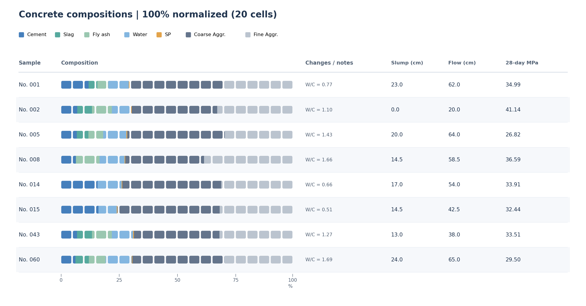
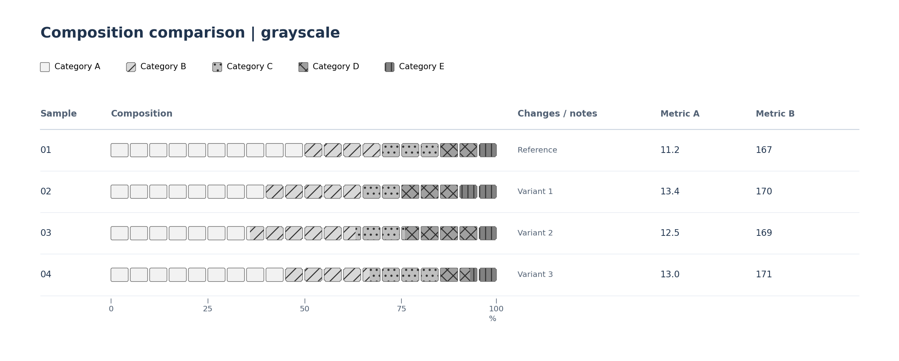

# compwaffle — Matplotlibによる端数対応ワッフルチャート

**v0.1.1：GitHub初回公開版**（PyPIでは配布しません）。配合・構成比などの数値を、角丸セルと端数セルで表すMatplotlibライブラリです。



## 主な機能

- 既定は1×20セル。行数・列数、セルサイズ、縦横間隔、描画順を指定可能。
- 端数セルを正確に塗り分け、セルの外形を共有。
- `PathPatch`で四隅だけを変形。`corner_bend`は−1〜+1で、負値はへこみ、0は角落とし、約0.5523は円弧に近い形状。
- カラー・角形状・ハッチングを各カテゴリに独立して割当て可能。
- 比率を100%に正規化するモードと、量を維持する可変長モード。
- 任意の成分（複数も可）を基準量100とする換算、密度を与えた質量→体積換算。
- 凡例、スケール、コメント、物性列付きの比較表。交互行背景は`show_stripes=False`で無効化可能。

## インストールと確認

```bash
python -m pip install -e '.[dev]'
python -m pytest -q
python examples/concrete_slump.py
python examples/shape_styles.py
```

## 基本例

```python
from compwaffle import waffle, parts_per_reference

values = {"Category A": 72.5, "Category B": 17.5, "Category C": 10}
fig, ax = waffle(values, columns=20, style="rounded", show_scale=True)
fig.savefig("waffle.svg")

amounts = {"Category A": 100, "Category B": 20, "Category C": 2.5}
parts = parts_per_reference(amounts, "Category A")
fig, ax = waffle(parts, mode="absolute", unit="parts",
                 value_per_cell=5, columns="auto")
fig.savefig("absolute.svg")
```

`mode="percent"`では合計100%に正規化します。`mode="absolute"`では元の量を保ち、`value_per_cell`で1セルの量を指定します。`parts_per_reference()`は基準成分の合計を100とする汎用変換です。`unit`は表示ラベルであり、単位換算を自動実行するものではありません。

## 色・形状・ハッチング

```python
from compwaffle import CornerShape, WaffleStyle, waffle_table

style = WaffleStyle(
    corner_span=0.10,
    color_map={"Category A": "#619BCE", "Category B": "#78A68C"},
    shape_map={"Category A": (0.10, 0.55),
               "Category B": CornerShape(0.10, -0.8)},
    hatch_map={"Category A": None, "Category B": "//"},
)
records = [
    {"label": "01", "composition": {"Category A": 75, "Category B": 25}},
    {"label": "02", "composition": {"Category A": 72.5, "Category B": 27.5}},
]
fig, ax = waffle_table(records, style=style, show_stripes=False)
```

個別形状は単一カテゴリの完全セルに適用し、端数・混在セルには共通マスクを使います。角の変形範囲を小さくすると面積差を抑えられますが、厳密に等面積ではありません。



## 公開データセット

同梱のUCI *Concrete Slump Test*（103件、原材料7種、評価値3種）で、比率型・基準量100に対する可変長型を検証できます。材料の数値と評価値は別列として扱います。

ソースとライセンス: I-Cheng Yeh (2007), [Concrete Slump Test](https://doi.org/10.24432/C5FG7D)、CC BY 4.0。プログラム本体はMITライセンスです。

[API詳細](docs/API.md) / [Python in Excelでの利用方法](docs/EXCEL.md)
