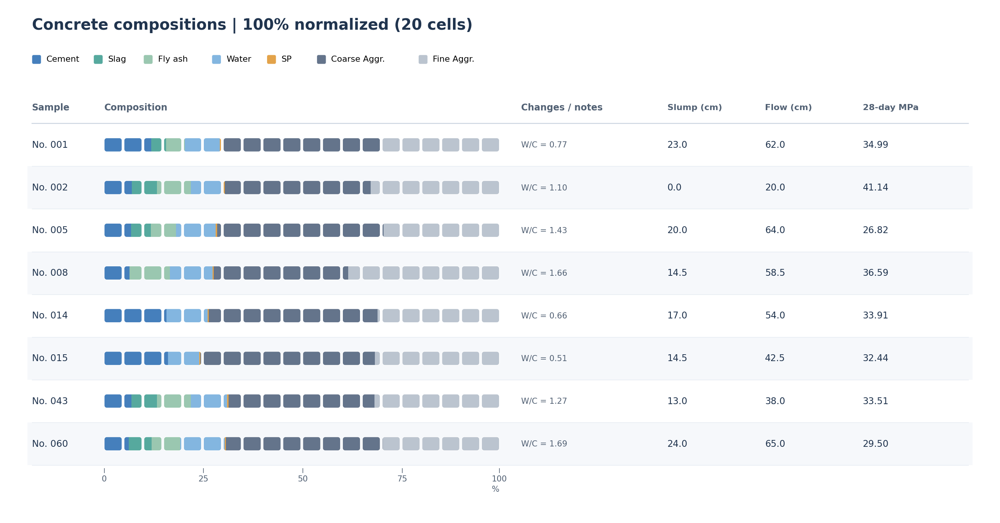
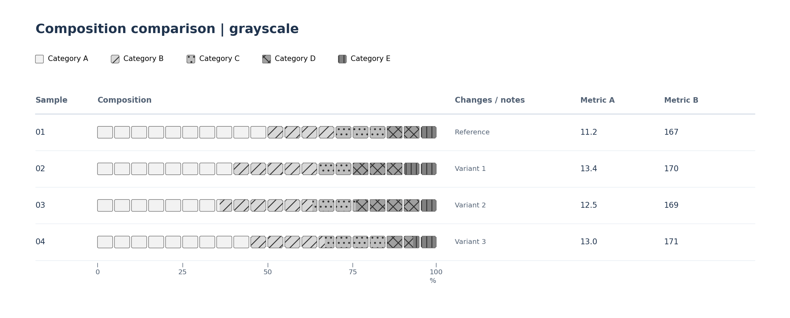
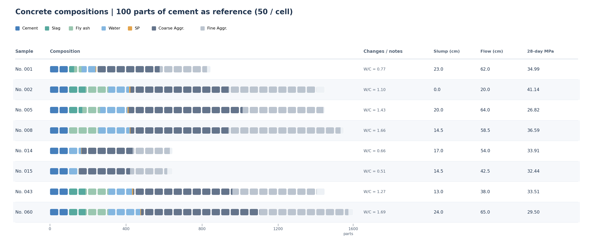

# compwaffle

**v0.1.3 (GitHub source; initial public release was v0.1.1).** Rounded, fractional-cell waffle charts for Matplotlib, with normalized and variable-length composition scales.

A cell can be divided among multiple categories without rounding their individual shares. Cell boundaries are cubic Bézier paths (`PathPatch`), with configurable convex or concave corners. Categories can be distinguished independently by color, shape, and hatch pattern.



## Features

- One-row waffles (20 cells by default) or configurable multirow grids, dimensions, spacing, and fill order.
- Fractional fills clipped to a single cell mask, including boundaries shared by multiple categories.
- Signed corner bend (−1 to +1), corner span, style presets, colors, and hatch patterns, with automatic per-color hatch darkening.
- Normalized percentages or absolute quantities with automatic variable-length rows and a shared scale.
- Conversion to parts relative to one or more selected reference categories, without implicit material-specific assumptions; mass-to-volume conversion with supplied densities.
- Titles, labels, legends, numeric scale for one-row charts, and experimental `waffle_table()` with property columns and optional row stripes.
- PNG, SVG, and PDF output; normal Matplotlib `.mplstyle` and `rc_context` support.
- **New in v0.1.3:** template-free CSV-to-XLSX generator for Python in Excel; supports up to 16 components and 256 plotted compositions, with English workbook labels.

## Install

Requires Python 3.10+ and Matplotlib 3.7+. From the repository directory:

```bash
python -m pip install -e .
```

To run tests and the public-data examples:

```bash
python -m pip install -e '.[dev]'
python -m pytest -q
python examples/concrete_slump.py
python examples/shape_styles.py
```

The core drawing package has no pandas dependency; the CSV plotting example uses pandas. The Python in Excel generator uses optional `lxml`.

## Python in Excel: create a workbook from CSV (v0.1.3)

Install the optional Excel generator and use the command line:

```bash
python -m pip install -e '.[excel]'
compwaffle-excel examples/python_in_excel/example_generic_7.csv -o waffle.xlsx
```

The workbook is generated **without any XLSX template**. It contains a `table`
sheet with the CSV data and a `waffle` sheet with editable styles, legend,
selected evaluation columns, and native Python in Excel plot cells. The drawing
engine is embedded in the file; **local compwaffle is not required to open or
recalculate it**. A supported Microsoft 365 Excel environment with Python in
Excel enabled is required to execute the embedded plots.

For custom CSV ranges and plotting options, write a short Python script:

```python
from dataclasses import replace
from compwaffle.excel import ExcelSettings, build_excel_workbook

base = ExcelSettings()
config = replace(
    base,
    composition_range="B2:Q257",        # 16 components, 256 data rows
    sample_id_column="A",
    evaluation_columns=("R", "S", "T"),
    options={**base.options, "hatch_tone_shift": -30},
)
build_excel_workbook("input.csv", "output.xlsx", config)
```

The CSV itself may contain additional columns and rows. Component columns are
selected explicitly rather than inferred from names. 

For the range conventions, workbook layout, security considerations and
troubleshooting, see [CSV to Python in Excel](docs/EXCEL.md).

## Normalized waffle

```python
from compwaffle import waffle

fig, ax = waffle(
    {"Category A": 72.5, "Category B": 17.5, "Category C": 10},
    columns=20, style="rounded", show_scale=True,
)
fig.savefig("waffle.svg")
```

The first category fills 14.5 cells. The mixed cell retains a continuous outline and a precise color boundary.

## Independent visual channels



```python
from compwaffle import CornerShape, WaffleStyle, waffle_table

style = WaffleStyle(
    corner_span=0.10,
    color_map={"Category A": "#619BCE", "Category B": "#78A68C"},
    shape_map={
        "Category A": (0.10, 0.55),
        "Category B": CornerShape(0.10, -0.80),
    },
    hatch_map={"Category A": None, "Category B": "//"},
    hatch_tone_shift=-30,  # auto hatch ink 30% toward black
)
records = [
    {"label": "01", "composition": {"Category A": 75, "Category B": 25}},
    {"label": "02", "composition": {"Category A": 72.5, "Category B": 27.5}},
]
fig, ax = waffle_table(records, style=style, show_stripes=False)
fig.savefig("comparison.svg")
```

`corner_span` is a fraction of the shorter cell dimension (0–0.5). `corner_bend` is in −1..+1: negative values recess the corners, zero makes straight chamfers, approximately 0.5523 makes circular-looking rounding. Only the corner regions change, so cell areas are close but not identical. Mixed or partial cells use the shared default mask to avoid gaps at internal boundaries. Shapes, colors, and hatches are resolved independently. Hatch ink defaults to 30% darker than each resolved fill color (`hatch_tone_shift=-30`): -100 is black, 0 keeps the fill color, and +100 is white. This is RGB mixing, not perceptual lightness. Set `hatch_color="#263445"` to override with a single shared color. The chart and legend use the same rule; the v0.1.3 generated workbook uses `waffle!B15` for the same setting.

Matplotlib controls the figure and axes backgrounds (`figure.facecolor`, `axes.facecolor`); `show_stripes=False` disables alternating table rows.

## Absolute scale and reference quantities

```python
from compwaffle import parts_per_reference, waffle

amounts = {"Category A": 100, "Category B": 20, "Category C": 2.5}
fig, ax = waffle(amounts, mode="absolute", unit="parts",
                 value_per_cell=5, columns="auto")
# 25 cells, including one half-filled end cell.

relative = parts_per_reference(amounts, "Category A")
# Category A = 100 parts; other values scale by the same denominator.
combined_reference = parts_per_reference(amounts, ("Category A", "Category B"))
# The sum of Category A + Category B is now 100 parts.
```

`mode="percent"` normalizes a composition to 100%. `mode="absolute"` preserves the input scale. Use one `value_per_cell` across records for meaningful variable-length comparisons. The `unit` string is a **display label**, not an implicit conversion. `parts_per_reference()` accepts arbitrary named reference categories; inputs must be in consistent units. For volume-based comparisons, use `mass_to_volume_parts()` with a density for every component.

## Table and embedded plots

`waffle_table(records, properties=(...), show_stripes=False)` aligns rows, optional comments, and numeric properties. Table layout is **experimental** and may require short column headings. `draw_waffle(ax, layout, palette, ...)` draws into an existing Matplotlib axes without altering its limits. `waffle(..., ax=ax)` is also available, but clears and configures that axes.

See the [API reference](docs/API.md) and the [Python in Excel setup notes](docs/EXCEL.md).

## Public dataset example

`python examples/concrete_slump.py` renders normalized and reference-based comparison tables using the bundled [Concrete Slump Test dataset](examples/data/README.md), containing 103 samples, seven input quantities (kg/m³), and three measured properties. The measured properties appear in separate table columns rather than in the composition.



Dataset: I-Cheng Yeh (2007), *Concrete Slump Test*, UCI Machine Learning Repository, [DOI:10.24432/C5FG7D](https://doi.org/10.24432/C5FG7D). The data is licensed **CC BY 4.0**, separately from the library code.

## License

Software and documentation: [MIT](LICENSE). Bundled dataset: [CC BY 4.0](examples/data/README.md) with attribution.
